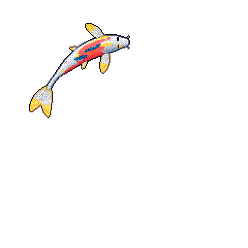

    <h1></h1>

    <h2>🚀 About Me</h2>
    
Mechatronic Engineering & Computer Science graduate from UNSW. Systems and design enthusiast.

    
Founder of <a href="https://www.bootink.com">Bootink</a>, where I'm currently building the website and our internal tooling.

<h2 align="center">🌐 Connect with Me</h2>

 To connect with me, you can find my linkedin below. I know everyone enjoys a quick linkedin snoop, including myself! Feel free to reach out :) 

  
  
  

<h2 align="center">🛠️ Featured Projects</h2>
<table>
  <tr>
    <td width="50%" valign="top">
      <h3><a href="https://github.com/gabrielpesquivel/Micromouse">Micromouse</a></h3>
      
Autonomous maze-solving robot on Arduino. DFS mapping, BFS shortest path, PID motion control and LiDAR/IMU/encoder sensor fusion.

      
<code>C++</code> <code>Arduino</code> <code>Robotics</code>

    </td>
    <td width="50%" valign="top">
      <h3><a href="https://github.com/gabrielpesquivel/CV-Hand-Gesture-Identifier">Hand Gesture Identifier</a></h3>
      
Real-time hand tracking and gesture recognition from a webcam feed, driving gesture-based controls.

      
<code>Python</code> <code>OpenCV</code> <code>MediaPipe</code>

    </td>
  </tr>
  <tr>
    <td width="50%" valign="top">
      <h3><a href="https://github.com/gabrielpesquivel/PCProfitPicker">PC Profit Picker</a></h3>
      
HackCU 11 build (24 hours, team of 4). Scrapes prebuilt PCs from eBay and Newegg and finds the profit in parting them out. <a href="https://github.com/gabrielpesquivel/pc-profit-picker-back">Backend</a> · <a href="https://devpost.com/software/pc-part-flipper">Devpost</a>

      
<code>TypeScript</code> <code>Python</code> <code>Hackathon</code>

    </td>
    <td width="50%" valign="top">
      <h3><a href="https://www.gabrielpesquivel.com">Personal Website</a></h3>
      
My portfolio site, with more on my projects and background.

      
<code>JavaScript</code> <code>Svelte</code>

    </td>
  </tr>
</table>

<h2 align="center">🌐 My contributions </h2>

 My recent activity on GitHub. 

    

<h2 align="center">🐟 My Koi</h2>

 A pixel-art koi drawn nightly from my GitHub activity by <a href="https://github.com/yalongwastaken/git-koi">git-koi</a>. 

    

<h2 align="center">💻 Tech Stack</h2>

<b>Languages</b>

<b>Web & Bootink</b>

<b>Data, ML & Vision</b>

<b>Tools & Cloud</b>

